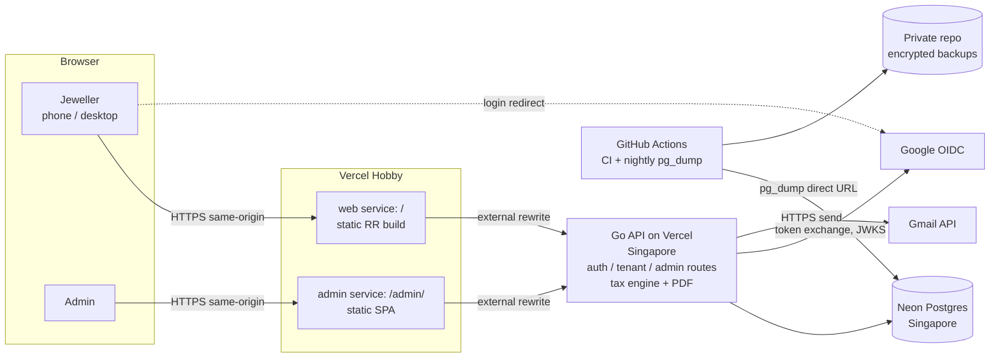
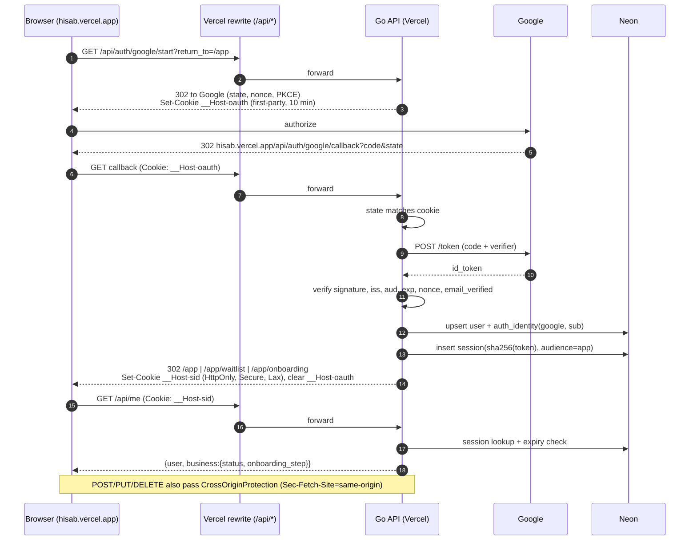

# Architecture

## 1. Stack

### Backend (`services/api`)
| Concern | Choice | Notes |
|---|---|---|
| Language | Go 1.25+ | Needed for `http.CrossOriginProtection`. |
| HTTP | stdlib `net/http` ServeMux | Patterns like `mux.Handle("POST /api/invoices/{id}/issue", …)`. Middleware is plain `func(http.Handler) http.Handler`. Route groups: `/api/auth/`, `/api/` (tenant), `/api/admin/`. |
| DB | `jackc/pgx/v5` (pgxpool, MaxConns 4) + `sqlc` | Neon **pooled** URL for queries, **direct** URL for migrations. |
| Migrations | `pressly/goose` v3, SQL files embedded via `embed.FS`, **run on boot** | Single instance, so there's no race. |
| Auth | `golang.org/x/oauth2` (code + PKCE) | No OIDC library: the ID token comes straight from Google's token endpoint over TLS, so its signature check may be skipped (OIDC Core §3.1.3.7 step 6). See §5. |
| PDF | `github.com/go-pdf/fpdf` (pinned) + embedded Noto Sans TTF | See §6. |
| Email | `EmailSender` interface with `gmail` (HTTPS Gmail API) and `console` drivers | No SMTP from serverless, and no domain. |
| Logging | `log/slog` (JSON in prod) | Vercel function logs capture stdout. |
| Config | `os.Getenv` into one struct, fail fast | No config library. |
| Tests | stdlib `testing` + real local Postgres | No mocks, no testcontainers. |

### Frontend
| Concern | Choice |
|---|---|
| `apps/web` | Vite + React 19 + TS, **React Router v8 framework mode**, `ssr: false`, `prerender: ["/", "/faq", "/privacy", "/terms"]`. Marketing routes ship as static HTML, and `/app/*` is the client-rendered dashboard. |
| `apps/admin` | Vite + React 19 + TS SPA, React Router library mode, `noindex`. |
| Styling | Tailwind CSS v4 with gold design tokens as CSS variables, Radix primitives |
| Animation | `motion` with `LazyMotion` + `domAnimation`. Respects `prefers-reduced-motion`. |
| Data / forms | React Router `clientLoader`/`clientAction` (no TanStack Query), react-hook-form + zod for the wizard |
| Shared | `packages/api/types.ts`, hand-written request/response types used by both apps |
| Display formatting | `Intl.NumberFormat('en-IN')` on BigInt rupees + manual paise (no floats). Words come from the server. |

## 2. Hosting (all free, no card, no domain)

| Piece | Host | Free limits (researched 2026-11-16) | Notes |
|---|---|---|---|
| Everything | **One Vercel Hobby project** `hisab` using **Services** (Beta), domain `hisab.vercel.app`. The root `vercel.json` routes `/api/*` and `/healthz` → `api`, `/admin/*` → `admin`, and everything else → `web`. | ~100 GB bandwidth/month; Hobby function limits; the API scales to zero (cold starts); no disk | **Hobby = non-commercial only.** Move to Pro before charging customers. |
| `web` service | `apps/web`, static build (`build/client`), SPA fallback `__spa-fallback.html` | | |
| `admin` service | `apps/admin`, Vite `base: "/admin/"`, built into `dist/admin/` (services receive the full path) | | Same origin as the app. Separate cookie name `__Host-asid`. |
| `api` service | `services/api`, Go preset (Beta). Vercel builds `cmd/api/main.go`, and the server listens on `PORT`. Function region `sin1`. | | Migrations run on cold start under an advisory lock. Plain `net/http`, so it moves to Render/Koyeb unchanged. |
| Postgres | **Neon Free**, Singapore | 1 GB storage, 100 CU-hours/month per project, scale-to-zero after 5 min | Easy data access: console SQL editor and table browser, any Postgres GUI, `pg_dump`, branches. Never paused or deleted. |
| Email | **Gmail API** (new Google account) | ~500 recipients/day | Separate GCP project. Consent screen in Production status so the refresh token doesn't expire after 7 days. |
| Backups | **GitHub Actions** cron → private repo `hisab-backups` (release assets) | Actions minutes: unlimited on public repos, 2,000/month private. One ~1 min job per night. | Keeps 30 daily + 12 monthly. |

**Rejected:**
- Render: sleeps after 15 min (~1 min wake). Render Postgres is deleted after 30 days.
- Railway: credit-based and not free long-term.
- Supabase: pauses after 7 days idle, 500 MB.
- Cloud Run: needs a card.
- Resend/Brevo: need a domain for real deliverability.

## 3. Monorepo layout

```
hisab/
├─ apps/
│  ├─ web/                      # marketing (/) + dashboard (/app/*)
│  │  ├─ app/
│  │  │  ├─ routes/             # marketing (prerendered) + app.* (SPA)
│  │  │  ├─ features/           # onboarding/, invoices/, parties/, items/, old-gold/, payments/, reports/
│  │  │  ├─ components/         # Button, Field, MoneyField, WeightField, Dialog, ...
│  │  │  └─ root.tsx
│  │  ├─ public/                # og image, robots.txt, sitemap.xml
│  │  └─ react-router.config.ts
│  └─ admin/
│     ├─ src/
├─ services/
│  └─ api/
│     ├─ cmd/api/main.go        # config, pool, migrate, mux, serve
│     ├─ internal/
│     │  ├─ server/             # handlers per area: auth, waitlist, admin, business, parties, items,
│     │  │                      # invoices, vouchers, payments, reports, admin
│     │  ├─ tax/                # pure engine + tests + fuzz (no deps)
│     │  ├─ inr/                # Indian grouping, amount in words (+ tests)
│     │  ├─ gstin/              # validate (+ tests)
│     │  ├─ docs/               # issue.go (numbering + snapshot), cancel.go: invoices & vouchers
│     │  ├─ pdf/                # classic_v1.go (template), fonts/NotoSans-*.ttf (embedded)
│     │  ├─ email/              # sender.go, gmail.go, console.go
│     │  └─ db/                 # sqlc output + tx helper
│     ├─ queries/*.sql
│     ├─ migrations/*.sql
│     ├─ seed/seed.sql
│     └─ sqlc.yaml
├─ packages/
│  └─ api/types.ts              # shared TS types (hand-written)
├─ docs/
├─ .github/workflows/           # ci.yml, backup.yml
├─ Makefile
├─ pnpm-workspace.yaml
└─ tsconfig.base.json
```
*ponytail: no shared UI package. Admin is a plain table UI, so copy the 3–4 components it needs. Extract a package when duplication hurts.*

## 4. Architecture diagram



**One API service.** Admin and tenant routes share one binary. They're separated by route prefix, session audience (`app` vs `admin`), and an allowlist re-check on every admin request.

## 5. Auth design

### Cookie / domain solution
- **One origin.** Vercel Services serve the web app, the admin app and the API from `hisab.vercel.app`, so every API call is same-origin and cookies are first-party. There's no cross-site rewrite and no proxy secret.
- Cookies are **host-only** with the `__Host-` prefix (`Secure; Path=/; HttpOnly; SameSite=Lax`, no `Domain`). App: `__Host-sid`. Admin: `__Host-asid`. Each session row has an `audience`, so an app cookie never authorises `/api/admin/*`.
- *ponytail: admin shares the app's origin (path `/admin/`). Move it to its own project/subdomain if XSS isolation between app and admin ever matters (staff users, more admins).*
- Local dev mirrors this with the Vite dev server `proxy: { '/api': 'http://localhost:8080' }`.
- **Phase 0 checks:** `Set-Cookie` round-trips through the service routing, and cold-start latency.

### OIDC flow
- `GET /api/auth/google/start`:
  - Generates `state`, `nonce`, and a PKCE verifier and stores them in a short-lived `__Host-oauth` cookie (HttpOnly, 10 min, Lax).
  - `return_to` must be a relative path.
  - Redirects to Google with `scope=openid email profile` and S256.
- `GET /api/auth/google/callback`:
  - Checks `state` and exchanges the code with the verifier.
  - The ID token comes directly from Google's token endpoint over TLS, so we read its claims without a JWKS signature check (OIDC Core §3.1.3.7 step 6) and check `iss`, `aud`, `exp`, `nonce`, and **require `email_verified`**.
  - Upserts `auth_identities(provider='google', subject=sub)`. The identity key is `sub`, not email.
  - Creates the session and redirects by business status.
- **Session:** 32 random bytes in the cookie. The DB stores `sha256(token)`. 7-day idle and 30-day absolute expiry. `last_seen_at` is written at most once an hour. Expired rows are pruned on login.
- **Logout:** deletes the row and clears the cookie.
- **CSRF:** `SameSite=Lax` + `http.CrossOriginProtection`, with trusted origin `https://hisab.vercel.app` (plus localhost in dev). GET handlers never mutate.
- **Admin:**
  - Separate callback on `hisab.vercel.app/api/admin/auth/google/callback`.
  - An `admin` session is created only if the email is in `ADMIN_EMAILS`.
  - Middleware on **every** `/api/admin/*` route checks audience == admin and re-checks the allowlist.
  - Admin sessions expire after 12 h.
- **Extensibility:** `auth_identities(provider, subject)` + `auth.LoginOrSignup(provider, subject, email, name)`. Phone OTP becomes `provider='phone'`.
- **Dev-only:** `POST /api/dev/login {email}` exists only when `APP_ENV=dev`. The process refuses to start if `APP_ENV=dev` with a non-localhost DB.

### Auth sequence



### Status gating
| Business status | Allowed |
|---|---|
| none | `/api/me`, `POST /api/waitlist` |
| `pending` / `rejected` | `/api/me`, `GET/PUT /api/waitlist` |
| `approved` (onboarding) | above + business, settings, rates, parties, items, onboarding |
| `active` | everything |
| `suspended` | read-only GETs, including PDFs |

## 6. PDF

**Decision:** generate on the server in Go with `go-pdf/fpdf`, from the stored snapshot, on every request (`GET /api/invoices/{id}/pdf`, `GET /api/purchase-vouchers/{id}/pdf`). **Nothing is stored.**

- **Why:**
  - English only.
  - Little memory: a few MB per render, well inside Vercel's function memory.
  - One language, so the same Go code does tax, words, and formatting.
  - No client bundle cost on low-end phones.
  - No storage used.
- **₹ and fonts:** Noto Sans Regular/Bold TTF embedded via `embed` and loaded with `AddUTF8Font`. All amounts are formatted by `internal/inr` (`7,37,864.00`).
- **Determinism:** `SetCreationDate` / `SetModificationDate` fixed to `issued_at`, and compression on. The template is a versioned function (`pdf.ClassicV1(snapshot)`) chosen by `snapshot.template.version`. A released version is never edited, and layout changes ship as `ClassicV2`. A test renders the same snapshot twice and asserts identical bytes, and keeps a golden SHA-256 for Bill A and Bill B.
- **Copies:** one PDF with one set of pages per copy in `snapshot.settings.copies`. Each set is labelled top-right "ORIGINAL FOR RECIPIENT" / "DUPLICATE FOR TRANSPORTER" / "TRIPLICATE FOR SUPPLIER".
- **Response:** `Content-Type: application/pdf`, `Content-Disposition: inline; filename="SJ-26-27-0148.pdf"`, `Cache-Control: private, max-age=86400` (issued bills never change).
- **Preview while drafting:** an HTML preview built from the `compute` response, with no PDF round-trip.
- **Alternatives rejected:**
  - Browser react-pdf: an extra client bundle and a second implementation.
  - Headless Chrome: too heavy for 512 MB.
  - HTML print: layout isn't deterministic.
